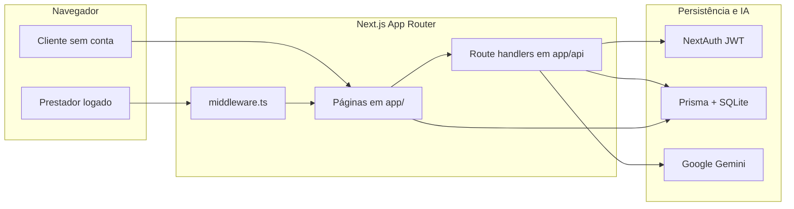
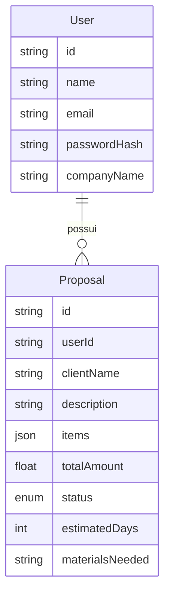
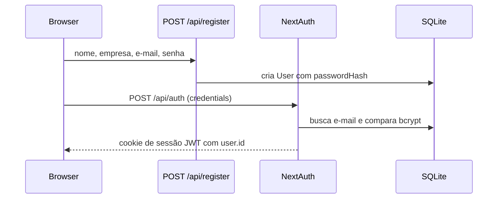
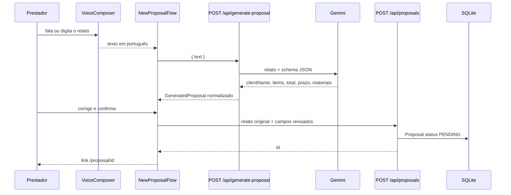

# Arquitetura do Nexos

Este documento descreve como o Nexos está organizado: orçamentos, receita, estoque e como o cliente responde a uma proposta sem precisar de conta.

## Visão geral

O Nexos é uma aplicação Next.js para prestadores de serviço: orçamentos com IA, receita e estoque. O prestador descreve um serviço, a IA monta o orçamento, ele corrige o que precisar e compartilha um link. Também acompanha finanças e controla materiais. Não há multi-tenant de organizações, fila, e-mail transacional nem painel de admin. Cada usuário é o próprio prestador e dono dos seus dados.



Há dois caminhos de leitura de dados:

- Páginas autenticadas (`/`, `/new`, `/settings`) são Server Components. Elas chamam `requireUser()` e o Prisma direto, sem passar pela API.
- A página pública `/proposal/[id]` também lê o Prisma no servidor.
- Mutações (gerar, salvar, editar perfil, aprovar, excluir) saem do cliente via `fetch` para os route handlers.

## Stack e responsabilidades

| Camada | Tecnologia | Papel |
| --- | --- | --- |
| UI | React 18, Tailwind, Radix Slot, Lucide | Telas, formulários e estados locais. |
| App | Next.js 14 App Router | Rotas, Server Components, route handlers e middleware. |
| Sessão | NextAuth 4, Credentials, JWT | Login por e-mail e senha. O token guarda o `id` do usuário. |
| Senha | bcryptjs, 12 rounds | Hash na criação da conta e comparação no login. |
| Dados | Prisma 6 + SQLite | Usuários e orçamentos. `items` é JSON. |
| IA | `@google/genai` | Transforma o relato em JSON de orçamento. |
| Voz | Web Speech API do navegador | Transcreve em `pt-BR` no cliente. Não envia áudio ao servidor. |

O runtime dos route handlers que usam Prisma ou bcrypt é `nodejs`. O middleware roda na edge e só lê o JWT (`getToken`), sem abrir o banco.

## Estrutura de pastas

```text
app/                  rotas de página e de API
  api/                route handlers
  login, register     telas públicas de conta
  new, settings       telas autenticadas
  proposal/[id]       orçamento público
components/           UI. Formulários interativos são "use client"
components/ui/        primitivos visuais (botão, card, input)
lib/                  regras de domínio, auth, Prisma, Gemini, dinheiro
prisma/schema.prisma  modelo de dados
middleware.ts         gate de autenticação
types/next-auth.d.ts  estende a sessão com user.id
```

`lib/` não importa componentes. Componentes de cliente importam só tipos e funções puras (`money`, `types`). Chamadas ao Prisma e ao Gemini ficam em páginas de servidor e em `app/api`.

## Modelo de dados

SQLite, definido em `prisma/schema.prisma`. O schema é aplicado com `npm run db:push`. Não há pasta de migrations.



`User` é o prestador. `email` é único. `passwordHash` nunca sai nas respostas da API.

`Proposal` pertence a um usuário (`onDelete: Cascade`). `description` guarda o relato original, não o texto gerado pela IA. `items` é um array JSON de `{ name, price }`. O total gravado é sempre a soma recalculada no servidor (`parseProposalInput`), não o total que o cliente mandou. `status` começa em `PENDING` e só muda para `APPROVED` ou `REJECTED`.

O código do orçamento mostrado na interface (`NX-` + 6 últimos caracteres do id) é derivado em `lib/money.ts`. Não existe coluna para isso.

## Autenticação e autorização



Configuração em `lib/auth.ts`. Provedor único: Credentials. Estratégia de sessão: JWT. Páginas customizadas: `signIn` aponta para `/login`.

Os callbacks copiam `user.id` para o token e depois para `session.user.id`. `lib/user.ts` usa essa id para buscar o registro no banco:

- `getCurrentUser()` devolve o usuário ou `null`.
- `requireUser()` redireciona para `/login` se não houver sessão. Usado nas páginas privadas.

O `middleware.ts` é a primeira barreira. Rotas públicas:

- `/login` e `/register`
- qualquer caminho que começa com `/proposal` (a página do cliente)
- `/api/auth/*` e `POST /api/register`
- `GET` e `PATCH` em `/api/proposals/:id` (leitura pública e decisão do cliente)

Todo o resto exige JWT. Sem token, páginas redirecionam para `/login?callbackUrl=...` e APIs respondem `401`.

Autorização fina fica nos handlers, não no middleware:

- Listar, criar e apagar orçamento exige o dono (`userId`).
- Atualizar nome, itens ou descrição exige o dono.
- Mudar status para `APPROVED` ou `REJECTED`, e somente o campo `status`, é público. Qualquer outra mudança de status exige o dono.
- `DELETE` devolve 404 se o id existir mas for de outro usuário, para não revelar a existência.

Quem já está logado e abre `/login` ou `/register` é mandado para `/`.

## Fluxo de um orçamento novo

A tela `/new` renderiza `NewProposalFlow`, uma máquina de estados no cliente: `input` → `loading` → `review` → `saved`.



### 1. Relato

`VoiceComposer` usa `SpeechRecognition` / `webkitSpeechRecognition` com `lang = pt-BR`, modo contínuo e resultados parciais. O áudio não sai do navegador. Se o navegador não suportar, o prestador digita. O servidor só recebe texto, com mínimo de 8 e máximo de 8.000 caracteres.

### 2. Geração

`POST /api/generate-proposal` exige sessão e chama `generateProposalFromText` em `lib/gemini.ts`. Nada é gravado nessa etapa.

O prompt de sistema pede um JSON fixo: nome do cliente, itens `{ name, price }`, total, prazo em dias e materiais. Regras importantes do prompt:

- Usar os valores ditos pelo prestador. `"2 mil"` vira `2000`.
- Se não houver valor, estimar preço de mercado no Brasil e marcar o item como estimativa.
- Se não houver nome, usar `"Cliente"`.
- Se não houver materiais, usar `"A definir com o cliente"`.

A chamada usa `responseMimeType: application/json` e um `responseSchema`. A temperatura é `0.2`. Há uma lista de modelos (`gemini-1.5-flash`, depois `gemini-3.6-flash`). O primeiro que responder fica em memória (`resolvedModel`) para as próximas gerações do mesmo processo. Modelo indisponível faz o código tentar o próximo. Chave ausente, inválida, cota esgotada e resposta vazia viram mensagens em português (`friendlyGeminiError`).

`normalizeGeneratedProposal` descarta markdown, valida itens, força prazo mínimo de 1 dia e recalcula o total com `sumItems`. O total do modelo não é confiável; a soma dos itens é.

### 3. Revisão e gravação

O rascunho no cliente inclui o relato original em `description`. O prestador pode alterar cliente, itens, prazo e materiais. `POST /api/proposals` passa o corpo por `parseProposalInput`:

- cliente e descrição obrigatórios
- pelo menos um item com nome e preço válido
- no máximo 50 itens
- prazo arredondado, mínimo 1
- `totalAmount` = soma dos preços, arredondada em centavos (`lib/money.ts`)

O registro nasce com status `PENDING`. A resposta é o `PublicProposal` (dados do orçamento mais nome, e-mail e empresa do prestador). A tela monta o link `${origin}/proposal/${id}` e oferece copiar.

## Orçamento público

`/proposal/[id]` é um Server Component. Busca o orçamento com o usuário dono. Se não existir, `notFound()`. `generateMetadata` monta título e Open Graph com valor e nome da empresa, para o link ficar apresentável ao colar no WhatsApp.

`PublicProposalView` mostra itens, total, prazo, materiais, relato e dados do prestador. Enquanto o status é `PENDING`, o cliente pode aprovar ou recusar. Isso é um `PATCH /api/proposals/:id` com corpo `{ status: "APPROVED" | "REJECTED" }` apenas. O middleware deixa essa rota pública; o handler só dispensa login nesse caso estreito.

A lista do prestador (`ProposalList` em `/`) lê os orçamentos no servidor, separa pendentes e soma os aprovados. Excluir chama `DELETE /api/proposals/:id`.

## Perfil da empresa

`/settings` carrega o usuário no servidor e entrega os campos iniciais ao `SettingsForm`. O salvamento é `PATCH /api/profile` (nome, e-mail, empresa). E-mail duplicado vira erro 400 por causa da unique constraint.

`isPlaceholderCompany` existe para o caso de um usuário com nome `"Seu nome"` e empresa `"Minha Oficina"`. A home mostra um aviso pedindo para completar o cadastro. O fluxo atual de registro já exige nome e empresa reais, então esse aviso só aparece para registros antigos com esses valores.

## Camada de domínio em `lib/`

| Módulo | Função |
| --- | --- |
| `prisma.ts` | Um `PrismaClient` reutilizado em desenvolvimento, para o hot reload não abrir conexão nova a cada request. |
| `auth.ts` | Opções do NextAuth. |
| `password.ts` | `hashPassword` e `verifyPassword`. |
| `user.ts` | Sessão → usuário do banco. |
| `gemini.ts` | Chamada ao modelo, fallback de modelo, normalização e erros amigáveis. |
| `proposal-input.ts` | Validação única de criação e edição. |
| `money.ts` | Parse de real (`1.500`, `1,50`, `R$`), soma, formatação `pt-BR`, código `NX-`, guarda de status. |
| `serialize.ts` | `Proposal` do Prisma → `ProposalListItem` ou `PublicProposal`. Datas saem em ISO. |
| `types.ts` | Tipos compartilhados entre servidor e cliente. Sem dependência do Prisma. |

`parseMoney` trata os dois jeitos brasileiros de escrever número (ponto de milhar com vírgula decimal, ou só vírgula). Preço negativo ou não numérico é descartado na hora de montar itens.

## Contrato das APIs

Todas devolvem JSON. Erros usam `{ error: string }` e mensagem em português.

| Método e rota | Auth | Efeito |
| --- | --- | --- |
| `POST /api/register` | Pública | Cria usuário. Senha mínima de 8 caracteres. `409` se o e-mail já existe. |
| `GET/POST /api/auth/[...nextauth]` | Pública | Login, logout e sessão do NextAuth. |
| `POST /api/generate-proposal` | Sessão | `{ text }` → orçamento gerado, sem gravar. `500` se falta a chave; `502` se o Gemini falha. |
| `GET /api/proposals` | Sessão | Lista só os orçamentos do usuário, mais recentes primeiro. |
| `POST /api/proposals` | Sessão | Cria orçamento `PENDING`. Resposta `201`. |
| `GET /api/proposals/:id` | Pública | Orçamento com dados da empresa. `404` se não existe. |
| `PATCH /api/proposals/:id` | Mista | Decisão do cliente é pública. Edição de conteúdo exige o dono. |
| `DELETE /api/proposals/:id` | Dono | Remove o orçamento. |
| `GET/PATCH /api/profile` | Sessão | Lê ou atualiza nome, e-mail e empresa. |

A lista da home não usa `GET /api/proposals`. Essa rota existe para o mesmo formato que `toListItem` produz, caso um cliente precise buscar de novo.

## Páginas e shell

`app/layout.tsx` define idioma `pt-BR`, fonte Geist local e o título "Nexos". Não há provider global de tema. A sessão do NextAuth é lida no servidor; os formulários de login usam `signIn` no cliente.

`AppShell` envolve `/`, `/new` e `/settings`: marca, nome da empresa, atalhos para empresa, sair e novo orçamento. A página pública não usa esse shell, para o cliente não ver a navegação do prestador.

`app/error.tsx` é o boundary de erro das páginas: mensagem genérica e botão para tentar de novo. `app/proposal/[id]/not-found.tsx` cobre id inexistente.

Páginas que leem o banco exportam `dynamic = "force-dynamic"`. Orçamento, lista e perfil não são cacheados entre requests.

## O que fica de fora

- Não há envio de e-mail nem WhatsApp. O prestador copia o link.
- Não há pagamento Pix do cliente na folha de orçamento — só aprovar ou recusar.
- Não há edição da página pública além de aprovar ou recusar. O prestador edita antes de salvar; depois disso a API até aceita `PATCH` de conteúdo pelo dono, mas a UI atual não oferece essa tela.
- O SQLite é arquivo local (`DATABASE_URL`). Serve para um processo. Vários servidores ou um deploy serverless com filesystem efêmero precisariam de outro banco e de `prisma migrate`, que este repositório ainda não usa.
- A escolha do modelo Gemini que funcionou vive só na memória do processo. Um restart volta a tentar a lista desde o início.
